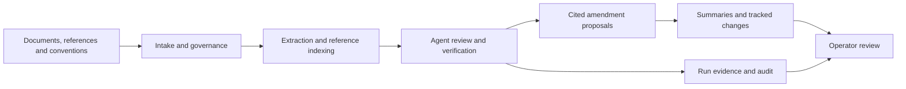

# Project Shimmer

Shimmer reviews documents against rules that the operator writes down. It reads
the documents, compares their figures and fields with those rules and with
supporting reference material, and proposes cited amendments for a person to
accept or reject. It never edits a source document. Every step leaves a record
that a reader can inspect.

**Status: v1, a prototype.** "v1" names this documented state of the repository;
its code version is the one in [VERSION](VERSION) (`0.1.0.dev6` at this commit).
Every result in this repository is a development
result on exposed material (material the project saw while it was being built).
None of it is a held-out or sealed result, and none of it shows how well Shimmer
works on documents it has not seen. A sealed evaluation is planned after v1. This
version is not released as a Python package, and no package release is promised.

On the four public benchmarks measured, Shimmer scores below the bare model on three (ContractNLI, ContraDoc and CUAD, where it found none of the gold flags) and about even on SciTab (F1 0.571 against 0.600); it leads only on the synthetic suite (F1 0.875 against 0.614), whose rules are the kind its own computations were built for. Today those computations rarely fire on the public benchmarks; the work that addresses it (more relations Python can compute, and the sealed evaluation) comes after v1. Details: [docs/RESULTS.md](docs/RESULTS.md).

## What Shimmer is

Shimmer puts together mechanisms that already exist. It does not introduce new
ones. The parts are:

- **Several agents that check each other across model families.** One model
  writes a draft; a model from another family checks it. This follows the
  multi-agent debate line of work, for example "Improving Factuality and
  Reasoning in Language Models through Multiagent Debate" (arXiv:2305.14325) and
  "Encouraging Divergent Thinking in Large Language Models through Multi-Agent
  Debate" (arXiv:2305.19118).
- **A constitution read at run time.** Seven seed laws and an append-only list of
  amendments, in [config/constitution.json](config/constitution.json). An agent
  may propose a change; only the operator can approve one, through a formal
  amendment process. Related work on runtime controls for language-model agents
  includes "RTBAS: Defending LLM Agents Against Prompt Injection and Privacy
  Leakage" (arXiv:2502.08966).
- **Arithmetic in code, not in a model.** Where a rule can be checked by
  arithmetic or by the presence of a field, Python checks it. A model is asked
  only where Python cannot decide.

The aim is review of documents where a missed defect is costly, such as
regulated documents. The fuller list of related work is in
[docs/history/README_PRE_ROUTING_AUDIT.md](docs/history/README_PRE_ROUTING_AUDIT.md),
section M (a dated copy of an earlier README).

## What it does and does not do

It does:

- Split each document into units (for example its sections) and decide which of
  the operator's rules could apply to which unit. This is the pairing map.
- Compute in Python every comparison it can: sums, products, bands, missing
  fields and changes from an earlier version of the same document.
- In paired review (the default with local models), ask a model only where
  Python computed nothing or the figures disagree. Wide review (the default with
  provider models) asks the reviewing agents over the whole document.
- Write amendments only from findings that Python computed. A finding a model
  wrote is kept, shown and marked in every file a reader gets: "Written by a
  model. Not promoted to an amendment. Not checked by Python." It never becomes
  an amendment.
- Save every model reply, the exact payload sent and the decoding settings under
  the run's `audit/model_replies/` folder (only hashes and lengths when redaction
  is on).
- Produce a JSON amendment record, Markdown summaries and a Word file with
  tracked changes, in English or Turkish.

It does not:

- Mask sensitive content in flight. See [Privacy](#privacy-law-iv).
- Serve more than one operator. See [Access](#access-one-operator).
- Offer a proven local Draft. Draft mode writes a memo with the drafter model of
  the chosen backend (Claude under Cloud, a local model under Local, with no
  provider call), then reviews it; local Draft is not yet proven end to end.
- Resume a stopped run from the middle.
- Feed what it stores across runs (the ontology) back into a review.
- Show any accuracy on unseen documents. Nothing measured so far can.

## How a review works

1. Supply the documents to review, supporting references and the review
   conventions (the operator's rules). Name earlier versions separately when you
   want a comparison.
2. Choose the backend and the privacy setting, read the intake summary and
   confirm.
3. Follow findings, citations, agent activity and any governed questions in the
   console. Look at refusals and coverage as well as proposed changes.
4. Review the summaries, the amendment record and the tracked-changes document.
   Keep the run's evidence with its deliverables.



The diagram shows how data moves. It does not mean the model calls run at the
same time. The [runtime reference](docs/RUNTIME_REFERENCE.md) describes each
agent, each output file, the server routes and the environment variables.

## What has been measured

The full results page is [docs/RESULTS.md](docs/RESULTS.md). Read it before
quoting any figure. Every figure there and here is **development, exposed**.

The table below copies the results page's summary as it stood on 31 October 2026.
If the two ever differ, the results page is the current one.

- **B3** is Shimmer, the whole pipeline in paired review. **B1** is the bare
  model: the main reading model given one fixed prompt per item, with no
  pipeline. "B1 tuned" carries the producer's tuned adapter.
- **Benchmark mode** counts a model judgement that the pipeline shows as advice
  as a finding. **As shipped (S-8)** counts only Python's findings: it is the
  adapters' sensitivity analysis S-8, which scores a run as if every
  model-written record were absent. This scoring rule was chosen after
  development scores had been seen.
- **Every benchmark here is a pilot:** each has fewer than 30 documents and fewer
  than 100 scored decisions.
- **Purpose of these runs:** development measurement and run health, on exposed
  material, with no seal and no manifest.
- Precision, recall and F1 are those of the benchmark's flag class (for example
  "contradiction" or "refutes"). "n/a" means nothing was flagged.

| Benchmark | Sample | B3 benchmark mode: P, R, F1 | B3 as shipped (S-8): P, R, F1 | B1 tuned: P, R, F1 | Minutes per document, B3 and B1 |
|---|---|---|---|---|---|
| ContractNLI | 2 agreements, 34 items | 0 of 5, 0 of 2, 0.000 | n/a, 0 of 2, n/a | 0 of 3, 0 of 2, 0.000 | 63.5 and 5.4 |
| SciTab | 3 tables, 14 claims | 4 of 7, 4 of 7, 0.571 | n/a, 0 of 7, n/a | 3 of 3, 3 of 7, 0.600 | 4.4 and 1.8 |
| ContraDoc | 3 documents, 3 items | n/a, 0 of 1, n/a | n/a, 0 of 1, n/a | 1 of 1, 1 of 1, 1.000 | 5.7 and 0.9 |
| CUAD | 1 contract, 41 categories | n/a, 0 of 34, n/a | n/a, 0 of 34, n/a | 24 of 27, 24 of 34, 0.787 | 109.2 and 9.7 |
| FinDVer | 1 filing, 1 item | not measured | not measured | not measured | 97.7 and 13.4 |
| Synthetic suite | 20 bundles, 48 planted rule items | 42 of 48, 42 of 48, 0.875 | 40 of 40, 40 of 48, 0.909 | 35 of 66, 35 of 48, 0.614 | 10.6 and 2.5 |

What these figures do not show:

- **Samples are tiny.** One to three documents per benchmark, one run per
  document. One item more or less changes a figure a great deal.
- **Some B3 runs still failed their execution checks after a second re-run**
  and are counted as failed: the CUAD contract and 2 of the 20 suite bundles.
  The results page names each one with its cause.
- **The synthetic suite is exposed by construction.** Its generators, seeds and
  answer keys are in this repository. It measures regressions, not recall on
  unseen material. On the suite's clean twins, B1 flagged 31 items and B3 in
  benchmark mode flagged 6; B3 in benchmark mode also wrote 45 records on units
  with no planted flaw.
- **The suite's generators were written by the same model family that builds
  Shimmer**, so the tests and the pipeline may share blind spots.
- **Public benchmark documents may have been seen by the models in training.**
- **Every B3 flag on the external benchmarks came from a model-written record.**
  Counting only Python's findings (as shipped, S-8), B3 flagged nothing on them.
  A review of model-written texts from one launch (ContractNLI, L11) found 9 of 15
  sampled texts wrong and 5 partly correct.
- **Not every field a sealed result report needs is here.** The fields the
  project's testing rules require of a result report (commit, test version and
  manifest hash, roles, scorer version, models and decoding, machine, cost,
  recall, attribution, false positives in every deliverable, clean-twin result,
  catch layer, directives, withheld agents, model-text review) are filled for
  the sealed evaluation, after v1. The results page gives those that apply to
  development runs.

**Which code was measured.** The runs were built from commits `8b48f78`,
`344522f`, `18eee21`, `d50b299`, `55f1dd1` and `2b585af`; labels and scores were
computed at `6fa01b9`. The second re-run of the entries that still failed (L12b)
was built from `d6ce19a`, which adds a decoding constraint on the output of
VERIFIER, PRACTICE_AUDITOR and ARCHIVIST and a larger VERIFIER output allowance
(4,096 tokens). So the rows that use an L12b run (one ContraDoc document, the
CUAD contract and 11 suite bundles) are on newer code than the rest; the results
page says which run each row uses. Changes made after `d6ce19a` were not
measured. There is no release-candidate commit.

**History.** The reports under `docs/fix/` from September 2026 describe runs on
tests whose keys the project had read. They are history, with their dates and caveats, and are not evidence of what Shimmer can do now.

## Limitations

- It is a prototype. Coverage depends on the corpus: Python can check only rules
  whose fields and scope the document and the conventions make usable.
- Model output can be incomplete, wrongly cited or self-contradictory. Read the
  marked model findings as unchecked.
- A finished process or a downloadable ZIP does not prove complete coverage.
  Check missing evidence, capped replies, failed contracts and unjudged rules
  before you accept a result.
- No figure shows accuracy on unseen documents.
- "Domain-agnostic" holds only in a narrow sense: no domain vocabulary is written
  in the code (it is declared in `config/domain_vocabulary.json`), and the
  pipeline has run on development material from several fields. The results
  differ widely from one field to another.
- The cloud backend (provider models) has no figure on the results page. Every
  measured run used open-weight models on a rented GPU.
- The FACT_CHECKER agent is switched off for every run from this repository
  (`config/review_scope.json`), because on an earlier test every item it returned
  in three runs was wrong. It stays registered, so the checks between model
  families are unchanged.

## Hardware and cost

These are measured figures, not estimates, except the laptop line, which is the
operator's recorded observation.

- **Rented GPU.** Every measured run used one NVIDIA A10 (24 GB) instance in
  us-east-1 at 1.29 USD an hour, read from the provider at each launch.
- **GPU memory.** An earlier ordinary run (v12, September 2026) peaked at 11.96 GB
  of 24 GB. A bare-model run on a full-length financial filing peaked at 18.6 GiB
  (base) and 20.9 GiB (tuned) allocated. A replay of auditor prompts peaked at
  21.89 GB allocated. In one launch, ten VERIFIER prompts of 44,467 to 54,657
  tokens ran out of GPU memory on the A10 before their first token; the prompt
  shown to VERIFIER was made smaller after that.
- **Time per document.** From 4.4 minutes (a SciTab table) to 109.2 minutes (a
  CUAD contract) for Shimmer, and 0.9 to 13.4 minutes for the bare model, on the
  instance, model loading included. See the table above.
- **Cost.** Instance time only, at the rate above: for example 2.73 USD for the two
  ContractNLI agreements and 4.57 USD for the 20 suite bundles. Each launch also
  spent about 15 minutes on setup, and each entry about 2 minutes. The loop's
  spending record is [docs/loop/BUDGET.md](docs/loop/BUDGET.md).
- **Laptop.** The project's standing rule (in [CLAUDE.md](CLAUDE.md)) records that
  on the development laptop (an 8 GB GPU) a single local run cost one to three
  hours and the machine paged memory at 15 GB of RAM. No run artifact backs those
  two figures. Full runs therefore go to a rented GPU.

## Install

Shimmer needs Python 3.12 (3.12.x; the sealed cloud profile pins 3.12.3, see
[tools/cloud_run/runtime.json](tools/cloud_run/runtime.json)) and the packages in
[requirements.txt](requirements.txt). The local backend also needs the configured
Qwen and Phi model files in the model cache, and a CUDA runtime. The bge-m3
embedding model is fetched from the network on first use when it is not cached.
The desktop starter installs nothing. The menu launchers install packages but not
the review models; their readiness check fetches the redactor's Qwen weights only
when `SHIMMER_QWEN_PULL=1` is set. The manual Windows steps below were run on a
fresh clone on 1 November 2026 (Windows 11, an 8 GB NVIDIA card): the packages
installed and torch saw CUDA after the third step. The full gate on that clone runs
at the v1 commit.

**Manual install (Windows).** These are the steps `shimmer.bat` runs, from the
repository root:

```powershell
py -3.12 -m venv .venv
.venv\Scripts\python.exe -m pip install -r requirements.txt --quiet
# only on a machine with an NVIDIA GPU, when torch reports no CUDA:
.venv\Scripts\python.exe -m pip install torch==2.5.1+cu121 --index-url https://download.pytorch.org/whl/cu121
```

On Linux or macOS, use `python3.12 -m venv .venv` and `.venv/bin/python` in the
same commands.

**Windows, menu launcher.** `shimmer.bat` creates `.venv`, checks that its Python
matches the runtime contract, runs `pip install -r requirements.txt`, installs the
CUDA build of torch when `nvidia-smi` finds a GPU and torch has no CUDA, asks for
the backend, runs the readiness check and shows a menu (review, chat, server,
gate, import). `SHIMMER_SKIP_INSTALL=1` skips the install and the torch step.

**Linux and macOS shell.** `./shimmer.sh` does the same as `shimmer.bat`, and in
Git Bash on Windows it uses an existing Windows `.venv` (`.venv/Scripts`).

**Windows, desktop console.** From the checkout, once the packages are installed:

```powershell
.\start_shimmer.bat
```

It finds a compatible Python (`tools/resolve_python.bat`), checks prerequisites,
starts the local server and opens the console in the browser. Use **Copy access
token** to connect the browser. Keep the starter window open and use **Stop
Shimmer** to stop the server; closing the browser leaves the server running.

**Container.** The [Dockerfile](Dockerfile) builds an image with an external model
cache, or with the weights baked in (`--build-arg BAKE_WEIGHTS=true`).
[compose.yaml](compose.yaml) runs a named image and does not build one. The entry
point takes `serve`, `run` or `verify`. The image has not been rebuilt for v1.

**Provider keys** (only for the cloud backend, Draft under Cloud included) live
outside the repository. Shimmer looks for them through `$SHIMMER_CONFIG_PATH`, then a sibling
`../api_keys/config.py`, then the path named in a repository-root `.env_path`
file. Never put a key in the repository.

## Quickstart

1. Create `input/context/` and `input/conventions/` (a fresh clone has no
   `input/` folder). Put the documents and their supporting material in
   `input/context/`, and the operator's rules in `input/conventions/`
   (`review_conventions.md` and `review_mandate.md`). `docs/INPUT_FORMAT.md`
   describes both. The menu launcher's import option ([5]) can place files and
   set the cutoff for you.
2. Start the console with `start_shimmer.bat`, choose Local or Cloud, paste the
   token and submit a review from the console. The
   [operator runbook](docs/RUNBOOK.md) walks through each screen.
3. Or run one review from the command line:

```powershell
py -3.12 scripts/pipeline.py --non-interactive --sensitivity-layer-inactive-override --no-redaction-override --backend-profile local
```

Without `--sensitivity-layer-inactive-override` every run exits with code 6,
because the privacy layer ships switched off. `--no-redaction-override` declares
the run redact-nothing: it switches redaction off for that run. Without it, a run
exits with code 4 when the local Qwen redaction model is not reachable, or when no
operator redaction rule compiles (the case for every corpus shipped in this
repository). Each override is written to the governance ledger.

`SHIMMER_INST_FINDER=off` switches the corpus-level agent INST_FINDER off for a
run, but only once the operator has ratified the amendment drafted in
`docs/INST_FINDER_SWITCH_DELTA_DRAFT.md`; until then a run with that setting
refuses to start (exit code 9, shown by the server and the console as the
governance status `refused_inst_finder_unratified`, not as a failure). Each run
records the setting in `audit/agent_switches.json` and its run summary.

4. Read the results in `output/runs/<run id>/deliverables/`: one folder per
   document, plus `_run_summary.md`. `docs/OUTPUT_FORMAT.md` describes the run
   folder.

## Configuration

- `input/conventions/`: the operator's rules. A rule heading can carry brackets
  that declare its severity, its scope (`[scope: ...]`) and the fields it requires
  (`[requires: ...]`).
- `config/review_scope.json`: the date cutoff that decides which documents are
  under review, and agents withheld for a review scope.
- `input/context/_review_targets.json`: an explicit list of the documents under
  review, and earlier versions to compare with. It wins over the date cutoff.
- `config/agent_registry.json`: which model each agent uses. Model names are read
  from the provider, never typed into code.
- `config/decoding_policy.json`: the frozen decoding settings for local models.
- `config/domain_vocabulary.json`: domain words that must never appear in code.
- Server settings are `SHIMMER_*` environment variables, listed in the
  [runtime reference](docs/RUNTIME_REFERENCE.md#server-environment).
  `SHIMMER_TOKEN_HASH` is required.

## The constitution and agents

The constitution has seven seed laws, from LAW-0 (the operator decides) to LAW-VI.
Two matter most in practice:

- **LAW-III, no self-audit.** No model checks output from its own model family.
  Locally, the producing agents run on a Qwen model and the auditing agents on a
  Phi model.
- **LAW-IV, protect what is private.** It cannot be overridden, not even by the
  operator.

Changes go only through the amendment process. A new amendment must carry the
next number and be marked operator-approved. `scripts/constitution_guard.py`
stops any edit or deletion of an existing amendment or seed law; it goes ahead
only with the operator's explicit approval. An agent can never approve one.

Shimmer registers 18 agents, each with one job (for example PROCESSOR extracts,
VERIFIER checks the draft against the source, PRACTICE_AUDITOR checks the
operator's rules, REDACTOR applies redaction rules, and six editorial ranks give
advisory review). Agents are activated by condition, so a run need not call
every agent. The
[runtime reference](docs/RUNTIME_REFERENCE.md) has the full table, with each
agent's provider and local models.

## Privacy (LAW-IV)

LAW-IV says that sensitive content must stay on local hardware. Today Shimmer
enforces that by refusing, not by masking. The masking layer
(`scripts/sensitivity_layer/`) is built and wired but switched off
(`LAYER_ACTIVE = False`). While it is off, the console refuses a Sensitive
submission, and a run starts only when the operator declares it non-sensitive
(`--sensitivity-layer-inactive-override`, which is logged); without that a run
exits with code 6.
Switching masking on needs its own operator-approved amendment (a DELTA).
Operator redaction rules, when the operator writes them, are applied locally and
checked by a search that the redacted text is gone.

## Access (one operator)

The server checks one shared access token: it stores only the token's SHA-256
hash (`SHIMMER_TOKEN_HASH`) and compares each request with it. There are no user
accounts and no per-caller records, so Shimmer is a single-operator system today.
Only `/health` and `/console` answer without the token; FastAPI's own `/docs`,
`/redoc` and `/openapi.json` pages are switched off.

## Testing rules

The project's testing rules bind every change, run, score and public statement.
In short:

- Every test used so far is exposed, and can be used only for development and
  regression.
- A sealed test is written, checked, run and scored by separate roles. The builder
  never sees its documents, key or per-item results, and nobody changes it after
  a result has been seen.
- A sealed test is fixed by a hash recorded before the run, with the code commit
  and the scorer.
- Every report states its purpose, whether its test is sealed or exposed, and
  which layer (Python or a model) produced each catch.
- No number is quoted publicly as evidence of what Shimmer can do until it holds
  on at least three independently prepared sealed tests on one code commit, with
  the spread reported.

The preregistration draft is
[docs/benchmarks/PREREGISTRATION.md](docs/benchmarks/PREREGISTRATION.md) and the
benchmark choice is [docs/benchmarks/SELECTION.md](docs/benchmarks/SELECTION.md).

## Reproducing the evaluation

- **Synthetic suite.** Regenerate it from its committed seeds and score a run with
  the repository scorer:

```powershell
py -3.12 benchmark/generators/generate.py suite dev
py -3.12 -X utf8 tools/score_corpus.py --key <answer_key.json> --run <run folder>
```

  [benchmark/dev_suite/README.md](benchmark/dev_suite/README.md) gives the twin
  options and the multi-round form.
- **External benchmarks.** The adapters in `benchmark/adapters/` build test
  bundles from a benchmark file, label a run's output and score the labels
  (`build`, `label --scoring benchmark|as_shipped`, `score`). `label` also writes
  the sensitivity analyses, S-8 among them; the "as shipped (S-8)" figures above
  are S-8, not `--scoring as_shipped`, which gives today's reading and can differ
  (on the suite, precision 42 of 46 against S-8's 40 of 40). The bare-model arm
  is `benchmark/baselines/bare_model.py`. No benchmark data is committed;
  `docs/benchmarks/SELECTION.md` names each source, version and licence.
- **Runs.** Full runs go to a rented GPU through the sealed controller
  (`tools/ordinary_final_bound_cloud.py`), which refuses a launch the budget
  cannot carry. The [cloud preparation guide](docs/CLOUD_RUN_PREPARATION.md)
  describes it.
- The run folders behind the results page are kept outside version control and
  are not published, so the published figures can be re-scored only where those
  folders are.

## Development and validation

Read [CLAUDE.md](CLAUDE.md) for the contribution rules and [genesis.md](genesis.md)
for the founding design. The design includes aims that are not built; the
[runtime reference](docs/RUNTIME_REFERENCE.md) describes what runs today, with
agent, route and environment tables that the gate checks against the code.

These checks block model and provider imports and network use, or use mocked
deployment transports. They launch no GPU workload:

```powershell
python -B -X utf8 scripts/report_recommendations_no_generation_gate.py
python -B -X utf8 scripts/brief_language_strategy_no_generation_gate.py
python -B -X utf8 tools/cloud_run_checks.py --json
python -B -X utf8 tools/cloud_run_transport_checks.py
python -B -X utf8 tools/cloud_run_transfer_checks.py
```

The full gate, `scripts/verify_session1.py`, includes checks that load models,
even with `--offline`. Run it only on a machine prepared for that. A passing
fixture check proves behaviour on that fixture, not review quality, privacy or
deployment readiness.

## Citation and licence

To cite Shimmer, use [CITATION.cff](CITATION.cff). The code is under the MIT
licence ([LICENSE](LICENSE)). The version is in [VERSION](VERSION) and the
changes are in [CHANGELOG.md](CHANGELOG.md).
