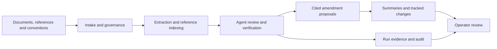

# How Shimmer works

What Shimmer is built from, what it does, how a review runs, the constitution and the
agents, the development checks and the history of this repository. This text was moved
from the README on 19 November 2026 (D-816); the short [README](../README.md) links here.
Results are in [RESULTS.md](RESULTS.md), limits in [LIMITATIONS.md](LIMITATIONS.md), and
installation in [INSTALL.md](INSTALL.md).

## Design and related work

Shimmer puts together mechanisms that already exist. It does not introduce new
ones. The parts are:

- **Several agents that check each other across model families.** One model
  writes a draft; a model from another family checks it. Models used as judges
  tend to favour their own outputs (Panickssery et al., 2024, arXiv:2404.13076),
  and more capable models make more similar mistakes (Goel et al., 2025,
  arXiv:2502.04313). A panel of judges from different model families is less
  biased than a single judge (Verga et al., 2024, arXiv:2404.18796). Shimmer does
  not use multi-agent debate (arXiv:2305.14325, arXiv:2305.19118), where copies
  of one model argue until they agree.
- **A constitution read at run time.** Seven seed laws and an append-only list of
  amendments, in [config/constitution.json](../config/constitution.json). An agent
  may propose a change; only the operator can approve one, through a formal
  amendment process. Related work on runtime controls for language-model agents
  includes RTBAS (arXiv:2502.08966), which checks each tool call against
  information-flow rules while the agent runs; Shimmer's laws concern document
  review rather than security.
- **Arithmetic in code, not in a model.** Where a rule can be checked by
  arithmetic or by the presence of a field, Python checks it. A model is asked
  only where Python cannot decide.

The aim is review of documents where a missed defect is costly, such as
regulated documents. The fuller list of related work is in
[history/README_PRE_ROUTING_AUDIT.md](history/README_PRE_ROUTING_AUDIT.md),
section M (a dated copy of an earlier README).

## What it does

- Read PDF, HTML and text files and say what it read of each: a PDF's
  annotations with their author, HTML insertions and deletions apart from the
  main text, and what it could not read (a PDF's structure, a scan with no text
  layer, a file that is not valid UTF-8). A file that gives no text is listed as
  an empty input in the run summary, never reviewed as if it were empty.
- Split each document into units (for example its sections) and decide which of
  the operator's rules could apply to which unit. This is the pairing map.
- Compute in Python every comparison it can: sums, products, bands, missing
  fields and changes from an earlier version of the same document.
- In paired review (the default with local models), ask a model only where
  Python computed nothing or the figures disagree. Wide review (the default with
  provider models) asks the reviewing agents over the whole document.
- Write amendments only from findings that Python computed. A finding a model
  wrote is kept, shown and marked in every file a reader gets: "Written by a
  model. Not promoted to an amendment. Not checked by Python." It never becomes
  an amendment.
- Save the reply of every model call a run makes (embedding calls aside), with
  the payload sent and the decoding settings, under the run's
  `audit/model_replies/` folder (only hashes and lengths of the texts when
  redaction is on).
- Produce a JSON review record (`review_data.json`), Markdown summaries and a Word
  file with tracked changes, in English or Turkish.
- Say, for every document it reads, which layers it read and which it found and
  could not read, with counts: for a Word file its tracked insertions and
  deletions with their authors, comments, footnotes and endnotes are read apart,
  and content controls, text boxes, nested tables and headers are counted. The
  record is printed when the document is loaded and written into
  `_run_summary.md`. A sum over a table column with merged cells is refused.

What it does not do is listed in [LIMITATIONS.md](LIMITATIONS.md#what-it-does-not-do).

## How a review works

1. Supply the documents to review, supporting references and the review
   conventions (the operator's rules). Name earlier versions separately when you
   want a comparison.
2. Choose the backend and the privacy setting, read the intake summary and
   confirm.
3. Follow findings, citations, agent activity and any governed questions in the
   console. Look at refusals and coverage as well as proposed changes.
4. Review the summaries, the review record and the tracked-changes document.
   Keep the run's evidence with its deliverables.



The diagram shows how data moves. It does not mean the model calls run at the
same time. The [runtime reference](RUNTIME_REFERENCE.md) describes each
agent, each output file, the server routes and the environment variables.

## The constitution and agents

The constitution has seven seed laws, from LAW-0 (the operator decides) to LAW-VI.
Two matter most in practice:

- **LAW-III, no self-audit.** No model checks output from its own model family.
  Locally, the producing agents run on a Qwen model and the auditing agents on a
  Phi model.
- **LAW-IV, protect what is private.** It cannot be overridden, not even by the
  operator.

Changes go only through the amendment process. A new amendment must carry the
next number and be marked operator-approved. `scripts/constitution_guard.py`
stops any edit or deletion of an existing amendment or seed law; it goes ahead
only with the operator's explicit approval. An agent can never approve one.

Shimmer registers 19 agents, each with one job (for example PROCESSOR extracts,
VERIFIER checks the draft against the source, PRACTICE_AUDITOR checks the
operator's rules, JUDGE answers narrow questions from the model's own
probabilities, REDACTOR applies redaction rules, and six editorial ranks give
advisory review). No shipped rule gives JUDGE a task yet. A table tool request
for JUDGE is built but off: once its amendment (approved in advance) is applied,
JUDGE may ask Python once per claim and table for a few registered, vetted table
tools (`config/table_tools.json`), none of which reaches the internet; until then
a run that declares it refuses to start.
Not every agent is called in every run: an agent can be
withheld by configuration or skipped when its input is missing, and each call or
skip is recorded. The
[runtime reference](RUNTIME_REFERENCE.md) has the full table, with each
agent's provider and local models.

## Development and validation checks

Read [CLAUDE.md](../CLAUDE.md) for the contribution rules (its full text is in [CLAUDE_REFERENCE.md](CLAUDE_REFERENCE.md)) and [genesis.md](../genesis.md)
for the founding design. The design includes aims that are not built; the
[runtime reference](RUNTIME_REFERENCE.md) describes what runs today, with
agent, route and environment tables that the gate checks against the code.

These checks block model and provider imports and network use, or use mocked
deployment transports. They launch no GPU workload:

```powershell
python -B -X utf8 scripts/report_recommendations_no_generation_gate.py
python -B -X utf8 scripts/brief_language_strategy_no_generation_gate.py
python -B -X utf8 tools/cloud_run_checks.py --json
python -B -X utf8 tools/cloud_run_transport_checks.py
python -B -X utf8 tools/cloud_run_transfer_checks.py
```

The full gate, `scripts/verify_session1.py`, includes checks that load models,
even with `--offline`. Run it only on a machine prepared for that. A passing
fixture check proves behaviour on that fixture, not review quality, privacy or
deployment readiness.

## History of this repository

The public history of this repository was rewritten on 2 November 2026 to remove
personal paths and a collaborator's project name from earlier commits (D-192). The
commit map at `docs/history/COMMIT_MAP.md`, on the tag `loop-v1`, gives the new hash
of every old commit, so that a hash cited in the project's records can still be
found. This branch keeps the local history, and the hashes its records cite are
the local ones, until the final stage (#179). Dated copies of earlier documents
are kept under `docs/history/`.
